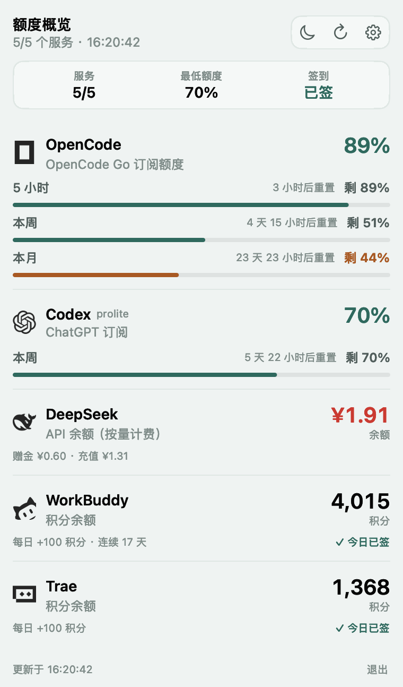
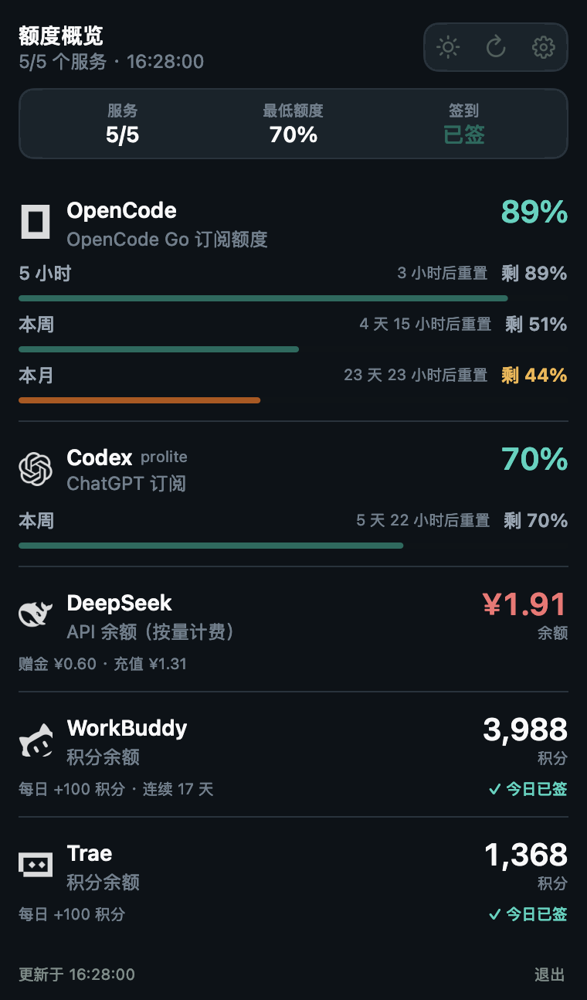
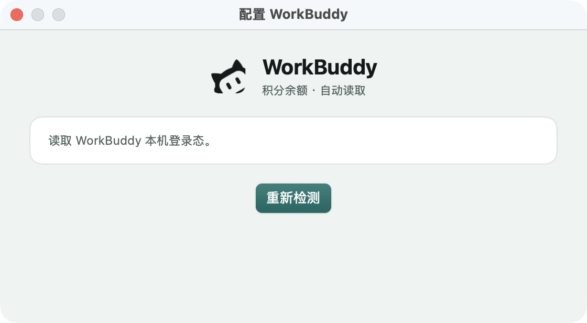
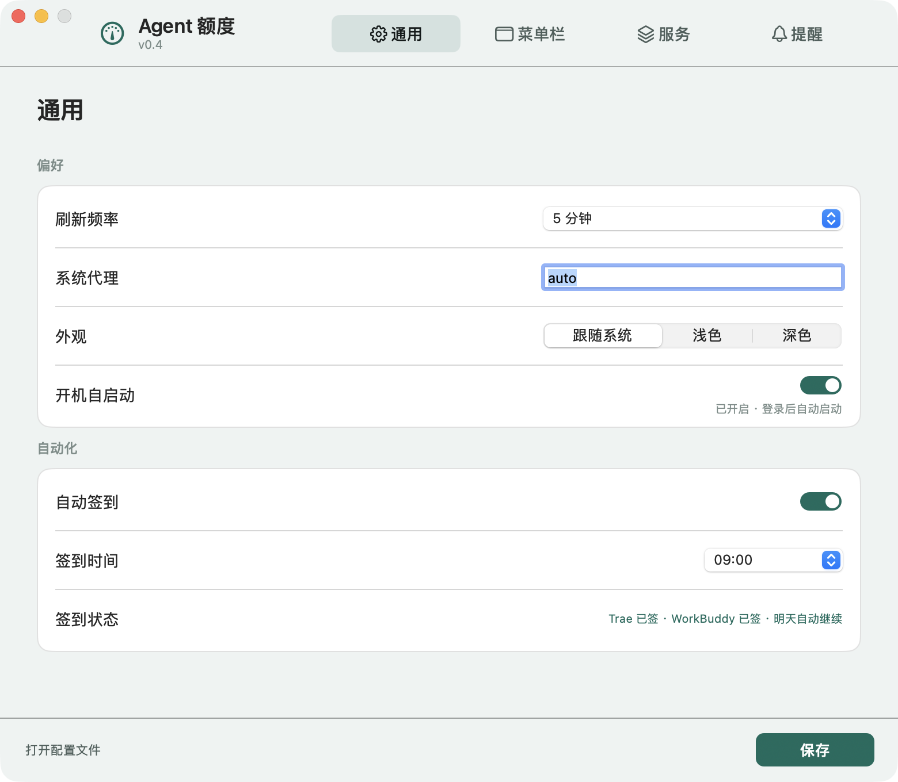
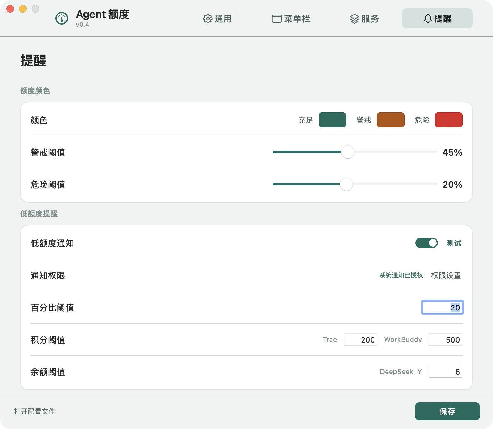
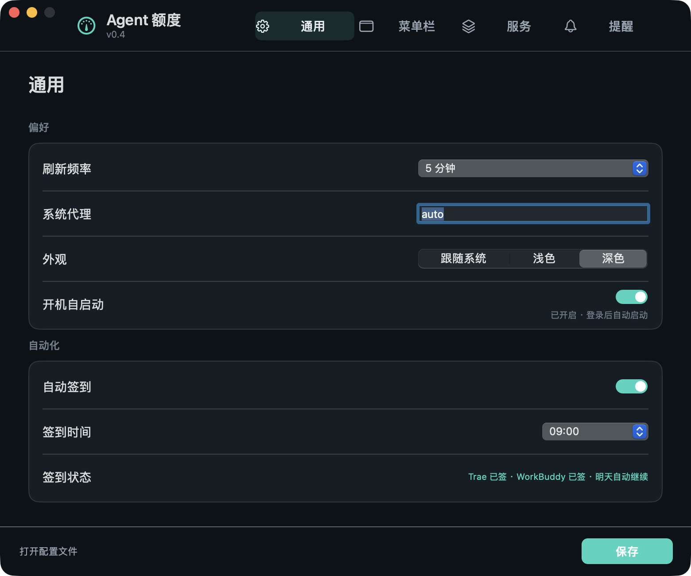

# AgentQuotaBar

macOS 菜单栏小工具：**OpenCode / Codex / WorkBuddy / Trae / DeepSeek** 的剩余额度，一眼看完。
原生 AppKit + 零依赖 Node collector，登录态复用本机已有凭据。


## 菜单栏


菜单栏分两种形态：

- **百分比制（OpenCode / Codex）**：白色 logo + 圆环，数字在环里；
- **余额/积分制（DeepSeek / Trae / WorkBuddy）**：不再画圆环，直接显示 `¥1.91`、`1,368`、`3,955` 这类具体数字。

- `≤20%` 红、`≤45%` 橙、其余青色；余额/积分用中性白字；异常显示 `!`。
- **图标大小可调**：设置 → 菜单栏 → 拖动滑块（80%–160%），菜单栏和预览实时变化。
- **自动切换**：谁的数值刚发生变化，菜单栏就切到谁（10 秒冷却，避免闪烁）。
- 所有 logo 都是透明背景的白色单色标记；WorkBuddy 使用透明猫脸，不再是白底方块。
- 圆环模式不额外留边距；积分/余额的数字模式才在右侧留 8pt，避免贴到隔壁 App 图标。



面板顶部是概览（服务数 / 最低额度 / 签到状态），下面是平面列表：品牌 logo、名称、套餐、大号数值、按额度维度拆分的进度与「剩 X%」、重置时间。**上下拖动任意一行即可排序**。

网络断开时不会用 0/5 和一大段 curl 报错覆盖面板：会保留最近一次成功快照（`~/.config/agent-quota/last-snapshot.json`），显示「网络未连接 · 显示上次数据」，并在网络恢复后自动刷新。

- 每条额度都有进度条（包括只有一条额度的 Codex）。
- Trae / WorkBuddy 的签到状态直接放在各自行里：已签显示「✓ 今日已签」，未签显示「签到」入口。
- 主数值和健康进度条统一使用青色；低于警戒/危险阈值才变橙/红，签到成功也是同一青色，避免多种绿。
- Trae 读取 v2 entitlement；WorkBuddy 用本机安全存储解出的 token 查剩余积分。



## 支持情况

| Provider | 菜单栏/面板 | 数据来源 | 需要手动配置 |
| --- | --- | --- | --- |
| Codex / ChatGPT | 本周剩余 % + 重置 | `~/.codex/auth.json` → 官方 usage 接口 | 否 |
| DeepSeek | 余额（¥） | 官方余额接口 | API Key |
| OpenCode | Zen 余额（$）或 Go 的 5h/周/月 | Console Cookie，或 Go API Key | 二选一 |
| Trae | 剩余积分 + 已用 / 总量 | 本机登录态 → `/trae/api/v2/pay/ide_user_ent_usage` | 否 |
| WorkBuddy | 剩余积分 + 连续签到天数 | 本机 WorkBuddy 安全存储自动解封 → 官方 billing 接口 | 否 |

## 安装

```bash
cd agent-quota-bar
./scripts/install.sh      # 构建 + 安装到 /Applications + 启动
# 启动后会自动安装后台签到 LaunchAgent
```

不想装到 Applications：

```bash
./scripts/build_app.sh
open dist/AgentQuotaBar.app
```

依赖：macOS 14+、Swift 6 命令行工具、Node.js 18+。

## 首次使用

Codex、Trae 自动读取本机登录态。其余：

1. 点菜单栏 → 未配置的行上点 **「配置」**；
2. **WorkBuddy / OpenCode Zen 会直接弹出内置浏览器登录窗口**，登录成功后自动抓取 token/cookie 并验证；
3. DeepSeek 还是官方 key（没有网页登录可抓），向导会打开 API keys 页面，复制粘贴即可。

### WorkBuddy 登录态

WorkBuddy 5.6+ 把桌面端 token 用 at-rest 信封加密，密钥只存在于运行中的 App 进程内存。现在的做法是调用 WorkBuddy 自己的 Electron 安全存储绑定拿到 `atRestSecretKey`，再按它的字段级 AAD 解封 accessToken；不弹 Keychain、不需要网页登录，也不读取明文 token 文件。

解出的 token 只用于本机查询 billing 接口，缓存密钥文件权限 600。



OpenCode 的 Zen 余额同理：内置浏览器登录后自动抓 `__Host-console_session` Cookie 和 workspaceId。

## 设置




设置收敛成 **4 页**：通用 / 菜单栏 / 服务 / 提醒。

- **通用**：刷新频率、系统代理、外观（跟随系统 / 浅色 / 深色）、开机自启动；
- **自动化**（同一页）：自动签到、签到时间、签到状态；
- **菜单栏**：自动切换 / 固定一家、图标大小、面板顺序；
- **服务**：每家 provider 的显示开关 + 实时状态 + 配置入口；
- **提醒**：充足/警戒/危险三种颜色、可拖拽的警戒/危险阈值、**积分阈值（Trae / WorkBuddy）与余额阈值（DeepSeek）分开设置**、低额度通知开关和百分比阈值、通知权限状态与测试通知；
- 面板右上角也直接有 **明暗切换**，不用进设置。

## 配置格式

`~/.config/agent-quota/config.json`（自动创建，600）：

```json
{
  "refreshSeconds": 300,
  "appearance": "system",
  "proxy": "auto",
  "menuBarMode": "auto",
  "menuBarProvider": "codex",
  "checkin": { "auto": true, "hour": 9, "lastDate": "", "lastSummary": "", "workbuddyStreak": 0 },
  "style": {
    "warningPercent": 45,
    "dangerPercent": 20,
    "healthyColor": "#22C55E",
    "warningColor": "#F59E0B",
    "dangerColor": "#EF4444",
    "thresholds": { "trae": 200, "workbuddy": 500, "deepseek": 5 }
  },
  "notifications": { "enabled": false, "percent": 20 },
  "providerOrder": ["opencode", "codex", "deepseek", "trae", "workbuddy"],
  "providers": {
    "codex": { "enabled": true },
    "deepseek": { "enabled": true, "apiKey": "sk-..." },
    "opencode": { "enabled": true, "mode": "go", "apiKey": "", "cookie": "", "workspaceId": "" },
    "trae": { "enabled": true, "edition": "cn" },
    "workbuddy": { "enabled": true, "token": "", "uid": "" }
  }
}
```

## 工作原理

```
┌────────────────────────┐     exec      ┌──────────────────────────────┐
│ AgentQuotaBar (AppKit) │ ───────────▶  │ collector.js (Node, 无依赖)   │
│  status item / 面板     │               │  curl + 各 provider adapter   │
│  设置 / 登录 WebView    │ ◀───────────  │  统一 JSON（stdout）          │
└────────────────────────┘     JSON      └──────────────────────────────┘
```

- 网络请求用系统 `curl`，自动支持系统代理和 TLS；
- 每个 provider 一个 `collectXxx()`，单家失败只影响自己那一行；
- 写入只有两处：保存配置、登录后写凭证；不会改第三方登录态。

## 每日签到

Trae 与 WorkBuddy 每天自动签到，默认 09:00，失败每 30 分钟重试。面板右上角有一个**一键签到**按钮，同时签 Trae 和 WorkBuddy；两个都签完后按钮自动隐藏。菜单栏右键的「一键签到 Trae + WorkBuddy」也会在完成后隐藏。

- Trae：`/trae/api/v2/ug/checkin_credits/status` + `/claim`；`x-device-id` 从本机 `storage.json` 的 `iCubeAuthInfo://icube-dc:<deviceId>` 读取，不能用自造设备号（否则返回 9074）
- WorkBuddy：`/v2/billing/meter/checkin-activity-status` + `/daily-checkin`
- 签到结果写入 `checkin.lastDate / lastSummary / workbuddyStreak`，面板对应行显示「✓ 今日已签」

**后台签到**：App 启动时安装一个 `com.agentquota.checkin` LaunchAgent，每小时检查一次；到设定时间且当天没签时才真正请求，App 没开着也会执行，结果写回配置。脚本在 `Resources/checkin-background.sh`，LaunchAgent 在 `~/Library/LaunchAgents/com.agentquota.checkin.plist`。

接口逻辑参考并适配自 [wb-trae-checkin](https://github.com/3338320742zh-collab/wb-trae-checkin) 与 [workbuddy-checkin](https://github.com/tars1230/workbuddy-checkin)，只保留 macOS 需要的部分，没有引入 Windows 计划任务/通知代码。

## 外观

设置 → 通用 → 外观，或直接点面板右上角的月亮/太阳。切换后立即重建窗口，不需要重启；菜单栏图标保持白色。




## 界面说明

设置改成**顶部 tab + 固定 780×680 窗口**，不再用左侧导航，也不会在切栏目时改变窗口大小。深浅色自适应：深色是蓝黑底 + 石墨卡片 + 薄荷绿强调色，浅色是薄荷雾底 + 白卡片 + 深青强调色；发丝分隔、连续圆角。没有灰色大底、渐变、发光或卡片堆。

## 项目结构

```
Sources/AgentQuotaBar/
├── AppDelegate.swift              # 状态栏、菜单、单实例逻辑
├── PopoverViewController.swift    # 平面列表面板 + 拖动排序
├── SettingsWindowController.swift # 设置
├── SetupWindowController.swift    # 每家配置向导
├── WebLoginWindowController.swift # 内置浏览器登录 + 自动抓凭证
├── MenuBarIcon.swift              # logo + 环 + 数字
├── ProviderLogo.swift             # 品牌 logo 加载/着色
├── ProviderStyle.swift            # 品牌色、严重程度阈值
├── QuotaStyle.swift               # 可配置颜色 / 阈值
├── NotificationService.swift      # 低额度通知
├── BackgroundCheckin.swift        # LaunchAgent 后台签到
├── QuotaService.swift / ConfigStore.swift / Models.swift
collector/collector.js             # 五家数据适配
collector/trae-crypto.js           # Trae tc 解密（MIT 署名）
Resources/logo-*.svg               # simple-icons（CC0）
docs/现有方案评估.md
```

## 已知限制

- Codex 只读 `auth.json`，不刷新 token；过期后重开客户端。
- OpenCode Zen 余额依赖 console cookie，会随浏览器会话失效（内置登录可续）。
- WorkBuddy 登录态失效时，重新打开 WorkBuddy 桌面端即可；App 会在下次刷新时重新解封。
- Trae 解密依赖客户端实现，客户端升级可能失效。
- 所有接口都是非公开接口，仅适合本机、本人账号、只读用途。
- 低额度通知依赖 App 运行；后台签到由 LaunchAgent 独立执行，不受影响。

## 商标与许可

- 品牌 logo 来自 [simple-icons](https://simple-icons.org)（CC0）；OpenAI / DeepSeek / Trae / OpenCode 商标归各自所有，仅用于本地识别。
- Trae 解密算法移植自 MIT 项目 [dsh-trae-api](https://github.com/Wang-JQ77/dsh-trae-api)。

## 卸载

```bash
pkill -f AgentQuotaBar
rm -rf /Applications/AgentQuotaBar.app
rm -rf ~/.config/agent-quota
rm -f ~/Library/LaunchAgents/com.agentquota.checkin.plist
launchctl bootout gui/$(id -u)/com.agentquota.checkin 2>/dev/null || true
```
