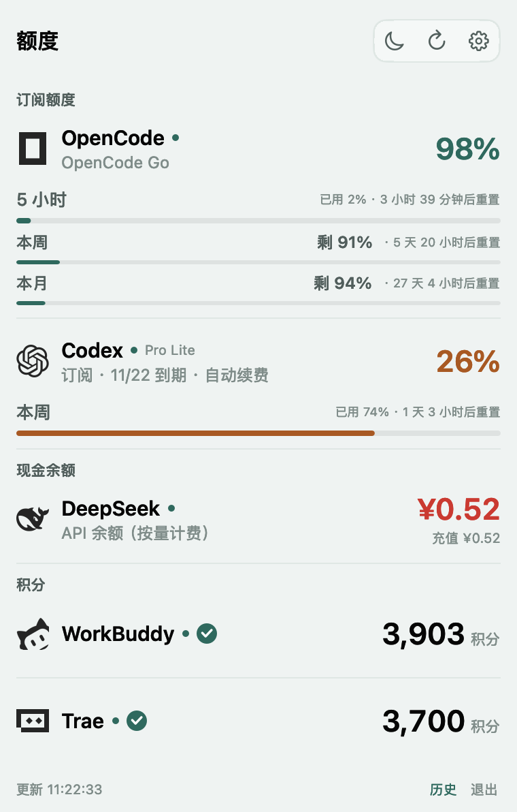
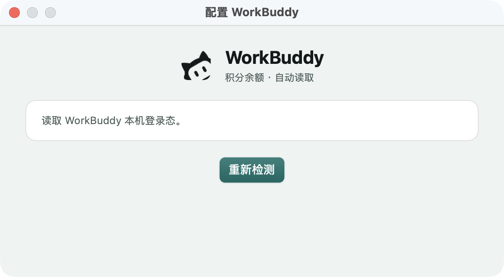
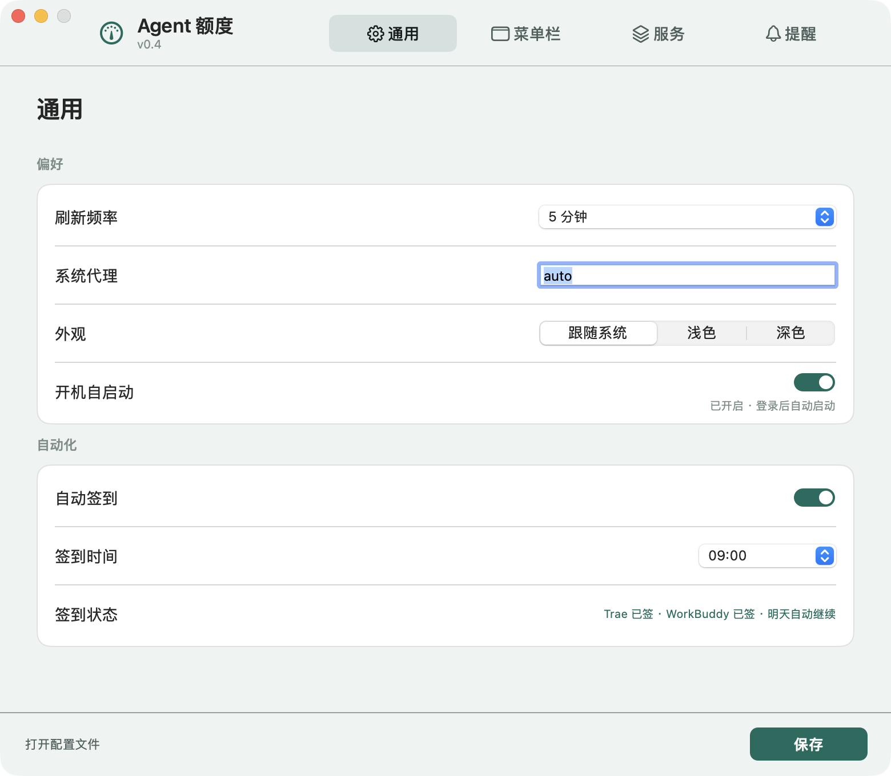
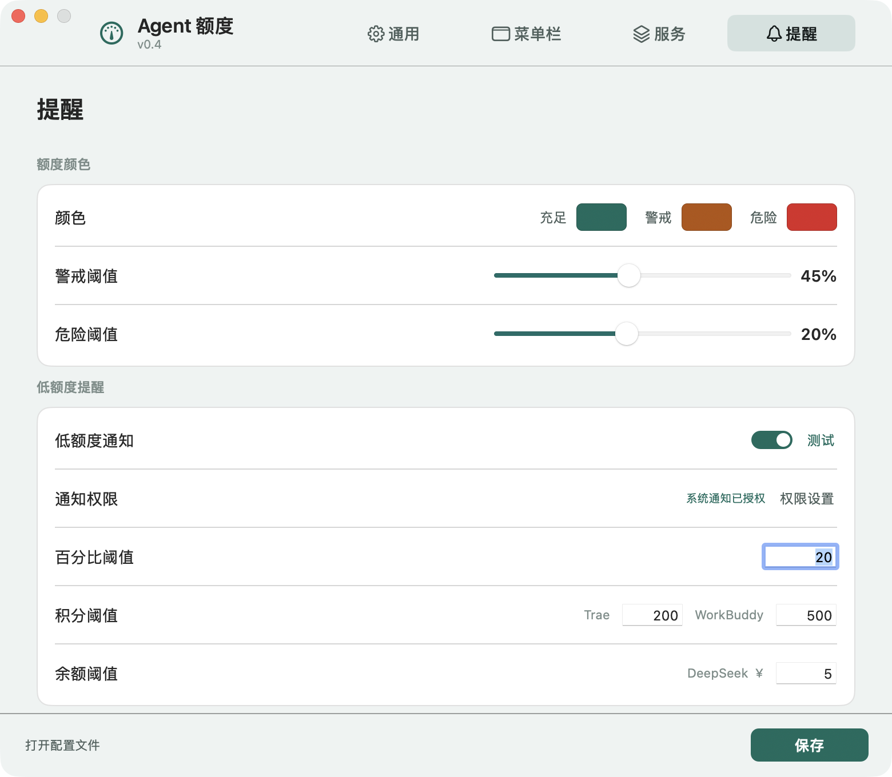
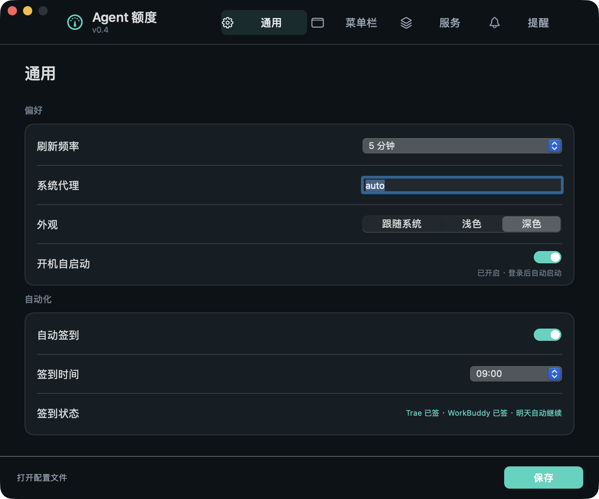

# AgentQuotaBar

macOS 菜单栏小工具：**OpenCode / Codex / WorkBuddy / Trae / DeepSeek** 的剩余额度，一眼看完。
原生 AppKit + 零依赖 Node collector，登录态复用本机已有凭据。按源码分发、需要本机构建，没有内置自动更新。

## 菜单栏


菜单栏分两种形态：

- **百分比制（OpenCode / Codex）**：单色 logo + 圆环，数字在环里；
- **余额/积分制（DeepSeek / Trae / WorkBuddy）**：不再画圆环，直接显示 `¥1.91`、`1,368`、`3,955` 这类具体数字。

- `≤20%` 红、`≤45%` 橙、其余青色；余额/积分用中性白字；异常显示 `!`。
- **图标大小可调**：设置 → 菜单栏 → 拖动滑块（80%–160%），菜单栏和预览实时变化。
- **自动切换**：优先跟随前台 App（OpenCode / Codex / WorkBuddy / Trae）；OpenCode 还会读取本地 session 时间，CLI/后台场景再回退到百分比 used 上升、积分 consumed 增加、DeepSeek 余额下降。签到 +100、窗口重置、充值上涨都不会抢菜单栏图标。
- 所有 logo 都是透明背景的单色标记，菜单栏图标会随浅色/深色菜单栏自动换墨色；WorkBuddy 使用透明猫脸，不再是白底方块。
- 圆环模式不额外留边距；积分/余额的数字模式才在右侧留 8pt，避免贴到隔壁 App 图标。



面板顶部只保留标题与刷新状态，没有概览卡片，高度全部给列表。每张卡片显示品牌 logo、名称、套餐与大号剩余值：百分比服务（OpenCode / Codex）额外显示按窗口拆分的消耗、进度与「剩 X%」、重置时间；余额/积分服务（DeepSeek / Trae / WorkBuddy）显示余额或积分，以及有变化时的今日消耗。**上下拖动任意一行即可排序**。

网络断开时不会用 0/5 和一大段 curl 报错覆盖面板：会保留最近一次成功快照（`~/.config/agent-quota/last-snapshot.json`），显示「网络未连接 · 显示上次数据」，并在网络恢复后自动刷新。单个 provider 的 SSL / DNS / 超时错误也会收成「SSL 连接失败」「DNS 解析失败」「连接超时」这类短提示，不再显示 curl 原文。

- 每个百分比窗口都有进度条（包括只有一条额度的 Codex）；余额/积分行不画进度条。
- 重置时间：24 小时内精确到分钟（`3 小时 50 分钟后重置`），超过 24 小时只显示到小时（`3 天 5 小时后重置`），避免过长。
- Trae / WorkBuddy 的签到状态直接放在各自行里：已签显示「✓ 今日已签」，未签显示「签到」入口。
- 百分比服务按窗口显示 `5 小时消耗 1%`、`本周消耗 9%`、`本月消耗 70%`，不把不同窗口相加。
- Trae / WorkBuddy 显示累计消费基线差：`今日 -100`；DeepSeek 按余额下降累计 `今日 -¥0.42`，没有变化就隐藏，不显示 `—` 或 `≈`。
- 主数值和健康进度条统一使用青色；低于警戒/危险阈值才变橙/红，签到成功也是同一青色，避免多种绿。
- Trae 读取 v2 entitlement；WorkBuddy 用本机安全存储解出的 token 查剩余积分。

## 支持情况

| Provider | 菜单栏/面板 | 数据来源 | 需要手动配置 |
| --- | --- | --- | --- |
| Codex / ChatGPT | 本周剩余 % + 重置 | `~/.codex/auth.json` → 官方 usage 接口 | 否 |
| DeepSeek | 余额（¥） | 官方余额接口 | API Key |
| OpenCode | Zen 余额（$）或 Go 的 5h/周/月 | Console Cookie（可 opt-in 从 Chrome 导入），或 Go API Key | 二选一 |
| Trae | 剩余积分 + 已用 / 总量 | 本机登录态 → `/trae/api/v2/pay/ide_user_ent_usage` | 否 |
| WorkBuddy | 剩余积分 + 连续签到天数 | 本机 WorkBuddy 安全存储自动解封 → 官方 billing 接口 | 否 |

## 安装

仓库按源码分发：没有签名/公证的预编译包，也没有自动更新。需要本机构建：

```bash
cd agent-quota-bar
./scripts/install.sh      # 构建 → 校验 → 原子安装到 /Applications → 启动
```

`install.sh` 先构建并校验产物（`Info.plist`、代码签名、`collector.js`、`workbuddy-key/`、后台脚本），全部通过后才替换旧 App；旧版本先备份，替换或校验失败会自动回滚，不会出现“装了一半、旧 App 也没了”。首次启动 App 时会自动安装后台签到与用量采样两个 LaunchAgent。

不想装到 Applications：

```bash
./scripts/build_app.sh    # 只生成 dist/AgentQuotaBar.app，并做签名校验
open dist/AgentQuotaBar.app
```

依赖：macOS 14+、Swift 6 命令行工具、Node.js 18+（App 运行时调用，支持 `/usr/local/bin`、`/opt/homebrew/bin`、`/usr/bin` 中的 node）。

## 首次使用

Codex 使用 OAuth 登录态，不使用 API Key；设置页可导入 `~/.codex/auth.json` 或复制 `codex login` 重新登录。Trae 自动读取本机登录态。其余：

1. 点菜单栏 → 未配置的行上点 **「配置」**；
2. **WorkBuddy / OpenCode Zen 会直接弹出内置浏览器登录窗口**，登录成功后自动抓取 token/cookie 并验证；
3. DeepSeek 还是官方 key（没有网页登录可抓），向导会打开 API keys 页面，复制粘贴即可。

### WorkBuddy 登录态

WorkBuddy 5.6+ 把桌面端 token 用 at-rest 信封加密，密钥只存在于运行中的 App 进程内存。现在的做法是调用 WorkBuddy 自己的 Electron 安全存储绑定拿到 `atRestSecretKey`，再按它的字段级 AAD 解封 accessToken；不弹 Keychain、不需要网页登录，也不读取明文 token 文件。

解出的 token 只用于本机查询 billing 接口，缓存密钥文件权限 600。



OpenCode 的 Zen 余额同理：内置浏览器登录后自动抓 `__Host-console_session` Cookie 和 workspaceId。

## 凭证、账号与成本

### 自动获取的凭证（auto-cookie）

- **OpenCode Zen**：内置浏览器登录 `opencode.ai` 成功后，自动从 WebKit cookie store 读取 `__Host-console_session`（兼容旧版 `auth`），再调 `/console/api/orgs` 取 workspaceId，写入 `providers.opencode.cookie / workspaceId / mode=zen` 并立即发一次请求验证。Cookie 会随会话过期，重新登录即可。
- **WorkBuddy**：登录页会从 localStorage/sessionStorage 抓 token/uid 写入配置；桌面端更常用的是 collector 通过 WorkBuddy 自带 Electron 安全存储解封 at-rest token（见上一节），不需要网页登录。
- **Trae / Codex**：没有网页登录可抓，直接复用本机 `storage.json` / `auth.json`。
- **Chrome Cookie 导入（显式 opt-in，默认关闭）**：需要手动改 `config.json` 开启，App 目前没有对应开关：

  ```json
  {
    "chromeCookies": {
      "profile": "Default",
      "dataDir": "",
      "keychainService": "",
      "keychainAccount": ""
    },
    "providers": {
      "opencode": { "autoCookie": true },
      "workbuddy": { "autoCookie": true }
    }
  }
  ```

  - 只读本机 Chrome 的 Cookies 数据库，按 `opencode.ai` / `www.workbuddy.cn` 域名筛选，并用 Chrome Safe Storage 口令解密 v10/v11 cookie；`dataDir` 留空时自动探测 `~/Library/Application Support/Google/Chrome`，`profile` 默认 `Default`。
  - 首次可能弹一次钥匙串授权；解密失败、数据库被锁或没有可用 cookie 都静默回退到手动凭据，不影响 App。
  - 手动 cookie/token 始终优先；OpenCode 的 `mode=go` 只走 API Key，不会读 Chrome。
  - cookie 只在内存里解密使用，不写日志、不写回配置。
- 手动填写或网页登录拿到的凭证最终落在 `~/.config/agent-quota/config.json`（600）；`scripts/quota` 不会打印这些字段。

### 多账号

每个 provider 支持一个账号数组，当前活动账号由 `activeAccount` 指定；旧版扁平字段（`providers.<id>.apiKey / cookie / token …`）继续兼容，没有 `accounts` 时会被当成唯一的“默认账号”：

```json
{
  "providers": {
    "opencode": {
      "enabled": true,
      "mode": "zen",
      "activeAccount": "work",
      "accounts": [
        {
          "id": "work",
          "label": "Work",
          "account": "me@example.com",
          "credentials": { "cookie": "…", "workspaceId": "…" },
          "createdAt": "2026-01-01T00:00:00Z",
          "updatedAt": "2026-01-01T00:00:00Z",
          "lastUsedAt": "2026-01-01T00:00:00Z"
        },
        {
          "id": "personal",
          "label": "Personal",
          "account": "alt@example.com",
          "credentials": { "apiKey": "…" }
        }
      ]
    }
  }
}
```

- 设置 → 服务：某家配置了多于一个账号时才显示账户下拉；切换会调用 `AccountStore.activate`，把选中账号的凭据镜像回扁平字段，兼容只读扁平配置的 collector，然后立即刷新。
- 当前 UI 只支持**切换**；新增/编辑/删除账号仍要改 `config.json`（或后续版本 UI），CLI 的 `accounts` 只读展示、不写入。手工编辑 `accounts[]` 后，建议在设置 → 服务里切换一次该账号，让凭据镜像到扁平字段，collector 才能读到。
- 凭据字段按 provider：Codex `authPath/codexHome`、DeepSeek `apiKey`、OpenCode `apiKey/cookie/workspaceId`、Trae `edition`、WorkBuddy `token/uid`。
- 同一时间只有一个活动账号，不能同时查询多个账号额度；`scripts/quota accounts` 只输出标签、账号标识和已填字段名，不会输出凭据值。

### 成本口径

面板和 CLI 的成本来自两类数据，都是本地估算、不是账单：

- **OpenCode**：读本机 `~/.local/share/opencode/opencode.db` 的 `session_message`（优先）或 `session_v2`，汇总今日/近 7 天成本（USD）和 token；`providers.opencode.costEnabled=false` 可关闭，`AGENT_QUOTA_OPENCODE_DB` 可指定别的库。数据库不存在或不可读时，输出里就没有 `cost` 字段。
- **DeepSeek**：相邻两次余额的下降额累加；充值 / 赠金上涨不计。
- **Trae / WorkBuddy**：累计 consumed 计数器 − 当天 0 点基线；签到 +100、套餐重置不计入。
- **Codex**：没有成本数据，只显示百分比窗口。
- 采样：App 运行时由 App 自己刷新；App 关闭后由 `com.agentquota.usage` 每 5 分钟采样。跨天自动清空，只保留“今天”。
- 参考值，不保证和账单一致；对账请以各家控制台为准。

### 历史

- App 每次成功拿到数据后（含单家定向刷新）会写 `~/.config/agent-quota/history.json`（600）：每个 provider 每天一条，保留最近 **7 天**，字段包括 `date / provider / usedPercent / remainingPercent / balance / consumed / cost / tokens / status / account / plan / updatedAt`；面板的 7 天趋势从这里读，OpenCode 成本行直接读本地库。
- `last-snapshot.json` 是离线缓存，不是历史；`usage.json` 只保留当天消费。
- CLI 兜底：App 没运行时，可用 `scripts/quota history --record` 把当天成本写到独立的 `history/YYYY-MM-DD.json`（与 `history.json` 不共用目录），再用 `scripts/quota history` 一并查看。

每天自动记录（cron 示例，路径按本机修改；有 App 在跑时通常不需要）：

```cron
50 23 * * * cd /path/to/agent-quota-bar && PATH=/opt/homebrew/bin:/usr/local/bin:/usr/bin:/bin ./scripts/quota history --record >/dev/null 2>&1
```

同一天重复执行会覆盖当天文件；`usage.json` 不是今天时 `--record` 会拒绝（加 `--allow-stale` 可强制）。

## 设置




设置收敛成 **4 页**：通用 / 菜单栏 / 服务 / 提醒。

- **通用**：刷新频率、系统代理、外观（跟随系统 / 浅色 / 深色）、开机自启动；
- **自动化**（同一页）：自动签到、签到时间、签到状态；
- **菜单栏**：自动切换 / 固定一家、图标大小、面板顺序；
- **服务**：每家 provider 的显示开关 + 实时状态 + 配置入口；配置了多个账号时出现账户下拉，可直接切换；
- **提醒**：充足/警戒/危险三种颜色、可拖拽的警戒/危险阈值、**积分阈值（Trae / WorkBuddy）与余额阈值（DeepSeek）分开设置**、低额度通知开关和百分比阈值、通知权限状态与测试通知；另有订阅到期（`notifications.subscriptionDays`，默认 3 天）、数据过期（`staleHours`，默认 12 小时）、凭据过期（`credentialDays`，默认 60 天）三类提醒，目前通过 `config.json` 调整阈值；
- 面板右上角也直接有 **明暗切换**，不用进设置。

## 配置格式

`~/.config/agent-quota/config.json`（自动创建，600）：

```json
{
  "refreshSeconds": 300,
  "appearance": "system",
  "proxy": "auto",
  "menuBarMode": "auto",
  "menuBarProvider": "codex",
  "checkin": { "auto": true, "hour": 9, "lastDate": "", "lastSummary": "", "workbuddyStreak": 0 },
  "style": {
    "warningPercent": 45,
    "dangerPercent": 20,
    "healthyColor": "#22C55E",
    "warningColor": "#F59E0B",
    "dangerColor": "#EF4444",
    "thresholds": { "trae": 200, "workbuddy": 500, "deepseek": 5 }
  },
  "notifications": {
    "enabled": false, "percent": 20,
    "subscriptionDays": 3, "staleHours": 12, "credentialDays": 60
  },
  "providerOrder": ["opencode", "codex", "deepseek", "trae", "workbuddy"],
  "chromeCookies": {
    "profile": "Default",
    "dataDir": "",
    "keychainService": "",
    "keychainAccount": ""
  },
  "providers": {
    "codex": { "enabled": true },
    "deepseek": { "enabled": true, "apiKey": "sk-..." },
    "opencode": {
      "enabled": true, "mode": "go", "apiKey": "", "cookie": "", "workspaceId": "",
      "autoCookie": false, "costEnabled": true
    },
    "trae": { "enabled": true, "edition": "cn" },
    "workbuddy": { "enabled": true, "token": "", "uid": "", "autoCookie": false }
  }
}
```

## 工作原理

```
┌────────────────────────┐     exec      ┌──────────────────────────────┐
│ AgentQuotaBar (AppKit) │ ───────────▶  │ collector.js (Node, 无依赖)   │
│  status item / 面板     │               │  curl + 各 provider adapter   │
│  设置 / 登录 WebView    │ ◀───────────  │  统一 JSON（stdout）          │
└────────────────────────┘     JSON      └──────────────────────────────┘
```

- 网络请求用系统 `curl`，自动支持系统代理和 TLS；
- 每个 provider 一个 `collectXxx()`，单家失败只影响自己那一行；
- 只写本机状态：`config.json`（含凭证）、`usage.json` / `history.json` / `last-snapshot.json`、两个 LaunchAgent plist；不会改第三方登录态。

## 命令行 / JSON 集成

`scripts/quota` 是零依赖 Node 小工具，直接复用仓库或已安装 App 里的 collector，不需要 App 在运行。完整字段、schema 和集成示例见 [docs/CLI.md](docs/CLI.md)：

```bash
./scripts/quota snapshot --pretty            # 实时查询一次，输出 collector 统一 JSON
./scripts/quota snapshot --only=deepseek     # 只查一家，避免全量请求
./scripts/quota cost --pretty                # 今日消费 + 余额/累计消费 + OpenCode 本地成本
./scripts/quota cost --live                  # 先实时刷新再算（默认读 last-snapshot.json）
./scripts/quota usage --pretty               # usage.json 原始状态（不含密钥）
./scripts/quota history --pretty             # App 7 天历史 + CLI 记录的每日成本
./scripts/quota history --record             # 兜底：记录今天成本到 history/YYYY-MM-DD.json
./scripts/quota accounts --pretty            # 多账号列表（不含凭据值）
./scripts/quota help
```

- `snapshot` 输出 collector schema（`schema / updatedAt / sampledAt / providers[]`），字段与 App 内部一致，适合 SketchyBar、状态栏脚本或 CI 做集成；可能含账号标识（email / uid），不要公开转贴。
- `cost` 输出 `{ schema, ok, day, stale, snapshotSource, snapshotAt, providers[{ id, name, unit, todaySpent, last7Days?, balance|consumed, tokens?, source?, sampledAt }] }`。DeepSeek / Trae / WorkBuddy 来自 `usage.json`，OpenCode 来自快照里的 `provider.cost`（本地库）。默认不联网，`--live` 才刷新；`stale: true` 表示 `usage.json` 不是今天。
- `history` 同时返回 `app`（`history.json`，近 7 天）和 `cli`（`history/YYYY-MM-DD.json` 兜底记录）；`--record` 只写 CLI 那份（0600、按天覆盖）。
- `accounts` 读取 `config.json`，输出每家 `accounts[]`、`activeAccount`、`mode`（`accounts` / `legacy` / `none`）以及 `credentialFields`（只列字段名）。
- `--only=id,id` 支持 `codex,deepseek,opencode,trae,workbuddy`；成本覆盖 DeepSeek / Trae / WorkBuddy / OpenCode。
- 环境变量：`AGENT_QUOTA_CONFIG` 可指向另一份配置（App / collector / CLI 共用，`usage.json`、`last-snapshot.json`、`history.json`、`history/` 都取同级目录）；`AGENT_QUOTA_COLLECTOR` 可指定 `collector.js` 路径。默认先找仓库 `collector/collector.js`，再找已安装 App 的 `Contents/Resources/collector.js`。

## 每日签到

Trae 与 WorkBuddy 每天自动签到，默认 09:00，失败每 30 分钟重试。面板右上角有一个**一键签到**按钮，同时签 Trae 和 WorkBuddy；两个都签完后按钮自动隐藏。菜单栏右键的「一键签到 Trae + WorkBuddy」也会在完成后隐藏。

- Trae：`/trae/api/v2/ug/checkin_credits/status` + `/claim`；`x-device-id` 从本机 `storage.json` 的 `iCubeAuthInfo://icube-dc:<deviceId>` 读取，不能用自造设备号（否则返回 9074）
- WorkBuddy：`/v2/billing/meter/checkin-activity-status` + `/daily-checkin`
- 签到结果写入 `checkin.lastDate / lastSummary / workbuddyStreak`，面板对应行显示「✓ 今日已签」

**后台任务（两个 LaunchAgent，App 首次启动时自动安装，之后每次启动刷新路径）**

| Label | 触发方式 | 作用 | 日志 |
| --- | --- | --- | --- |
| `com.agentquota.checkin` | 每小时整点检查，到设定时间且当天未签才真正请求 | 后台签 Trae / WorkBuddy | `~/.config/agent-quota/checkin.log` |
| `com.agentquota.usage` | 每 300 秒 + 登录时（App 运行时跳过；App 内 DeepSeek 每 60 秒、Trae/WorkBuddy 跟随整包刷新） | 采样 DeepSeek / Trae / WorkBuddy 的余额或累计消费 | `~/.config/agent-quota/usage.log` |

- plist：`~/Library/LaunchAgents/com.agentquota.checkin.plist`、`~/Library/LaunchAgents/com.agentquota.usage.plist`；
- 用量采样只覆盖 **DeepSeek（余额）、Trae / WorkBuddy（累计消费）**，不采集 OpenCode / Codex；
- 状态写在 `~/.config/agent-quota/usage.json`（600，`NSDistributedLock` 文件锁），App 关闭也继续记录；
- App 运行期间另有 60 秒一次的 DeepSeek 余额采样（只刷新 DeepSeek 一行，用于累计今日消费）；
- 签到脚本是 App 内的 `Contents/Resources/checkin-background.sh`；用量采样直接调用 App 可执行文件的 `--usage-sample`。移动 App 后重新打开一次，LaunchAgent 路径会自动更新。

**日志与状态文件**

| 路径 | 内容 |
| --- | --- |
| `~/.config/agent-quota/config.json` | 配置（含 API Key / token / 多账号，600） |
| `~/.config/agent-quota/usage.json` | 今日消费累计（DeepSeek / Trae / WorkBuddy） |
| `~/.config/agent-quota/last-snapshot.json` | 最近一次成功快照（离线时展示，不是历史） |
| `~/.config/agent-quota/history.json` | App 的 7 天额度/成本历史（600） |
| `~/.config/agent-quota/workbuddy-at-rest` | WorkBuddy at-rest 密钥缓存（600） |
| `~/.config/agent-quota/checkin.log` | 后台签到输出 |
| `~/.config/agent-quota/usage.log` | 后台用量采样输出 |
| `~/.config/agent-quota/history/YYYY-MM-DD.json` | CLI `history --record` 的兜底成本记录（可选，与 history.json 分开） |

接口逻辑参考并适配自 [wb-trae-checkin](https://github.com/3338320742zh-collab/wb-trae-checkin) 与 [workbuddy-checkin](https://github.com/tars1230/workbuddy-checkin)，只保留 macOS 需要的部分，没有引入 Windows 计划任务/通知代码。

## 外观

设置 → 通用 → 外观，或直接点面板右上角的月亮/太阳。切换后在原窗口更新颜色，不丢未保存输入，也不需要重启；菜单栏图标会按当前菜单栏明暗自动换墨色。




## 界面说明

设置改成**顶部 tab + 固定 780×680 窗口**，不再用左侧导航，也不会在切栏目时改变窗口大小。深浅色自适应：深色是蓝黑底 + 石墨卡片 + 薄荷绿强调色，浅色是薄荷雾底 + 白卡片 + 深青强调色；发丝分隔、连续圆角。没有灰色大底、渐变、发光或卡片堆。

## 项目结构

```
Sources/AgentQuotaBar/
├── AppDelegate.swift              # 状态栏、菜单、单实例、刷新调度
├── PopoverViewController.swift    # 面板 + 拖动排序 + 7 天趋势
├── SettingsWindowController.swift # 设置 + 多账号切换
├── SetupWindowController.swift    # 每家配置向导
├── WebLoginWindowController.swift # 内置浏览器登录 + 自动抓凭证
├── MenuBarIcon.swift              # logo + 环 + 数字
├── ProviderRegistry / ProviderActivity / RefreshScheduler.swift
├── CostStore.swift                # OpenCode 本地成本
├── HistoryStore.swift             # history.json（7 天）
├── AccountStore.swift             # 多账号配置
├── ProviderLogo.swift / ProviderStyle.swift / QuotaStyle.swift / Theme.swift
├── NotificationService.swift / BackgroundCheckin.swift / CheckinService.swift
├── QuotaService.swift / ConfigStore.swift / UsageTracker.swift / UsageSampler.swift
collector/collector.js             # 五家数据适配（打包进 Contents/Resources/）
collector/trae-crypto.js           # Trae tc 解密（MIT 署名）
collector/workbuddy-key/           # 调 WorkBuddy Electron 读 at-rest 密钥的 helper，随 App 一起打包
scripts/build_app.sh               # 构建 + 生成 Info.plist + ad-hoc 签名/校验
scripts/install.sh                 # 校验后原子安装（备份/回滚）
scripts/uninstall.sh               # 卸载 App / LaunchAgent / 本地数据
scripts/quota                      # CLI：snapshot / cost / usage / history / accounts
Resources/logo-*.svg               # simple-icons（CC0）
docs/现有方案评估.md
docs/CLI.md                        # CLI 字段与 JSON schema 明细
```

## 已知限制

- Codex 只读 `auth.json`，不刷新 token；过期后重开客户端。
- 访问 `chatgpt.com` 这类需要代理的域名时先走系统代理，代理失败会自动直连重试。
- OpenCode Zen 余额依赖 console cookie，会随浏览器会话失效（内置登录可续）。
- WorkBuddy 登录态失效时，重新打开 WorkBuddy 桌面端即可；App 会在下次刷新时重新解封。
- Trae 解密依赖客户端实现，客户端升级可能失效。
- 所有接口都是非公开接口，仅适合本机、本人账号、只读用途。
- 多账号目前只支持在设置页“切换”已配置账号；新增/编辑/删除账号仍要改 `config.json`，且同一时间只能查询一个活动账号。
- 成本是本地估算：DeepSeek / Trae / WorkBuddy 来自采样差值，OpenCode 来自本地库，Codex 没有成本；不保证与账单一致。
- `history.json` 只保留最近 7 天；更长的历史需要自己导出/归档。
- 低额度通知依赖 App 运行；后台签到由 LaunchAgent 独立执行，不受影响。

## 分发、更新与许可

- **分发**：按源码分发，需要本机安装 Xcode 命令行工具构建；不提供预编译包。
- **更新**：没有内置自动更新（没有 Sparkle 之类的更新器）；升级就是重新拉代码后执行 `./scripts/install.sh`。
- **签名**：本地构建使用 ad-hoc 签名（`codesign --sign -`），未做 Apple 公证（notarization）。首次打开若被 Gatekeeper 拦截，用「右键 → 打开」即可；仅建议本机自用。
- **许可**：本仓库目前**没有 LICENSE 文件**，即未附带开源许可证；对外分发或再发布前请自行补充。
- 品牌 logo 来自 [simple-icons](https://simple-icons.org)（CC0）；OpenAI / DeepSeek / Trae / OpenCode 商标归各自所有，仅用于本地识别。
- Trae 解密算法移植自 MIT 项目 [dsh-trae-api](https://github.com/Wang-JQ77/dsh-trae-api)。

## 卸载

```bash
./scripts/uninstall.sh                    # 注销并删除两个 LaunchAgent，保留 App 与配置
./scripts/uninstall.sh --app              # 再删除 /Applications/AgentQuotaBar.app（先停止运行实例）
./scripts/uninstall.sh --purge            # 再删除 ~/.config/agent-quota（配置/用量/日志/密钥缓存）
./scripts/uninstall.sh --all              # App + 本地数据全部删除
./scripts/uninstall.sh --dry-run --all    # 只打印将执行的动作
```

`uninstall.sh` 处理 `com.agentquota.checkin` 与 `com.agentquota.usage` 两个 job 及对应 plist。开机自启动走 SMAppService 登录项，不是 LaunchAgent；卸载前可在 App 设置 → 通用里先关闭。卸载后再打开 App 会重新安装两个后台任务。
